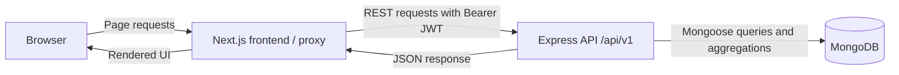
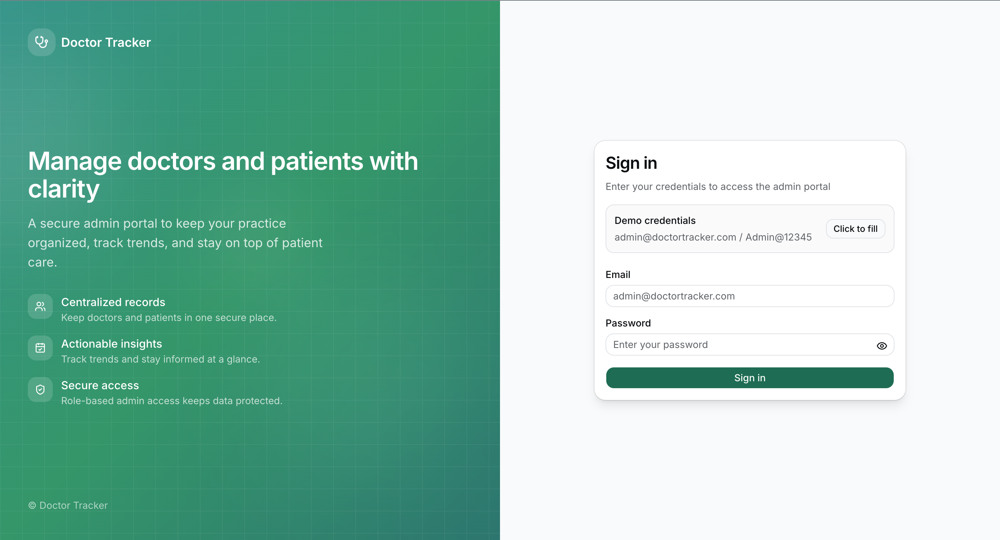
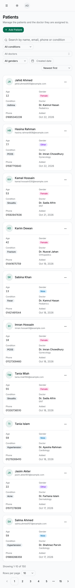

# Doctor Tracker Backend

## Elevator Pitch

The backend is an Express and TypeScript REST API for the admin portal. It validates inputs with Zod, stores doctors, patients, and admin users in MongoDB through Mongoose, and exposes authenticated management and dashboard endpoints under `/api/v1`.

**Live demo**

- Frontend: `<LIVE_FRONTEND_URL>`
- Backend: `<LIVE_BACKEND_URL>`
- [Frontend repository](https://github.com/HafijurRahmanBhuiyan/doctor-tracker-frontend)
- [Root Compose repository](https://github.com/HafijurRahmanBhuiyan/doctor-tracker)

## Setup Guide

### A. Docker

From the root repository, with `backend/` and `frontend/` checked out beside the root Compose file, run:

```bash
docker compose up --build
```

For this repository alone, `docker compose up --build` uses its local Compose file to start MongoDB and the API. The API is available at `http://localhost:5001/api/v1`; this mapping avoids macOS AirPlay on host port 5000. The root Compose setup also starts the frontend on port 3000. Defaults are in the root [`.env.example`](../.env.example); the backend-specific [`.env.example`](.env.example) documents local process settings.

### B. Manual

Prerequisites: Node.js 20 (the version used by the backend Dockerfile), npm, and MongoDB 7 or a compatible MongoDB deployment. If MongoDB is not already running locally, start a local instance in a separate terminal (or start your installed MongoDB service):

```bash
mkdir -p /tmp/doctor-tracker-mongo
mongod --dbpath /tmp/doctor-tracker-mongo --bind_ip 127.0.0.1 --port 27017
```

On macOS, choose `PORT=5001` because AirPlay may occupy host port 5000.

```bash
cp .env.example .env
# Edit .env: set MONGO_URI for your MongoDB and PORT=5001 if port 5000 is occupied.
npm ci
npm run seed
npm run dev
```

The dev script runs `tsx watch src/server.ts`. On startup the server connects to MongoDB, seeds the admin account from `ADMIN_EMAIL` and `ADMIN_PASSWORD`, backfills missing search tokens, and seeds demo data only when `SEED_DEMO_DATA=true`. The explicit `npm run seed` command runs the demo seeder; it only adds the demo set when the database has no doctors. Set `SEED_DEMO_DATA=true` if you want startup seeding instead. The default admin credentials are `admin@doctortracker.com` / `Admin@12345` when configured that way. The backend listens on `PORT` (5000 by default); use host port 5001 on this Mac if needed.

Environment variables below come from `src/config/config.ts` and `.env.example`.

| Variable | Required | Default in `.env.example` | Description |
| --- | --- | --- | --- |
| `PORT` | No | `5000` | HTTP listen port. |
| `MONGO_URI` | Yes | `mongodb://localhost:27017/doctor-tracker` | MongoDB connection URL. |
| `JWT_SECRET` | Yes | `your-super-secret-jwt-key-change-in-production` | Signing secret; replace with a strong secret before deployment. |
| `JWT_EXPIRES_IN` | Yes | `7d` | JWT lifetime passed to the JWT signer. |
| `CLIENT_URL` | Yes | `http://localhost:3000` | Comma-separated list of allowed browser origins; every entry must be a URL. |
| `ADMIN_EMAIL` | No | `admin@doctortracker.com` | Email for the seeded admin. |
| `ADMIN_PASSWORD` | No | `Admin@12345` | Password for the seeded admin. |
| `RATE_LIMIT_WINDOW_MS` | No | `900000` | General per-IP rate-limit window in milliseconds. |
| `RATE_LIMIT_MAX` | No | `600` | General maximum requests per IP per window. |
| `LOGIN_RATE_LIMIT_MAX` | No | `20` | Login attempts per IP per login limiter window. |
| `SEED_DEMO_DATA` | No | `false` | When `true`, seed demo doctors/patients at startup if no doctors exist. |
| `NODE_ENV` | No | `development` | Runtime mode (`development`, `production`, or `test`). |

## System Architecture



The frontend owns the browser experience and route protection; it calls the backend REST API directly for application data. Login returns a JWT. The frontend stores it in the `dt_token` cookie, the Next.js proxy reads that cookie to protect dashboard, doctor, and patient routes, and API requests send it in an `Authorization: Bearer` header. The Axios response interceptor removes the cookie and navigates to `/login` after a 401.

List pages keep search, filters, dates, sorting, and pagination in URL query parameters. TanStack Query uses those parameters as query keys and requests paginated API results. The backend validates query/body shapes, uses indexed Mongoose queries, and returns `{ success, data, message, meta? }`. Dashboard statistics are produced by parallel MongoDB counts and aggregations.

With Compose, the three containers share a private Docker network. Only frontend port 3000 and backend host port 5001 are published; MongoDB is not published. The root setup details are in the [root repository](https://github.com/HafijurRahmanBhuiyan/doctor-tracker); the [frontend repository](https://github.com/HafijurRahmanBhuiyan/doctor-tracker-frontend) contains the UI.

## Technical Decisions

### 1. Indexed word-prefix search, compound filter/sort indexes, and aggregation-based analytics

- **Problem:** Support useful search and filtering without turning list requests into broad scans, while keeping dashboard summaries practical as data grows.
- **Options considered:** Case-insensitive contains/regex search; MongoDB text search; precomputed search tokens with anchored prefixes; and per-record joins versus grouped analytics.
- **Decision:** Doctor and patient writes maintain normalized `searchTokens`; search splits case-insensitive input into words, treats punctuation as separators, and ANDs anchored prefixes across token values. The models declare these indexes: Doctor `email_1` (unique), `createdAt_-1`, `name_1`, `searchTokens_1_createdAt_-1`, `specialization_1_createdAt_-1`, `hospital_1_createdAt_-1`; Patient `doctor_1_createdAt_-1`, `gender_1_createdAt_-1`, `createdAt_-1`, `name_1`, `searchTokens_1_createdAt_-1`, `age_1`, `condition_1_createdAt_-1`, `doctor_1_searchTokens_1_createdAt_-1`. Dashboard specialization totals group patients by doctor before joining doctor specializations. Date-only `from` and `to` use Asia/Dhaka day boundaries. List limits are capped at 50.
- **Trade-offs:** Word-prefix matching is indexed but intentionally does not match a substring in the middle of a word. Tokens require maintenance on every write and a startup backfill. Indexes add storage and write work; exact sort/filter combinations determine whether an index can satisfy the query.
- **Evidence:** The isolated performance scripts seed 500 doctors and 30,000 patients. The recorded explain run covered 30 query shapes: zero were flagged, list queries used IXSCAN and took 0–7 ms, and common prefixes `a`, `m`, `s`, and `me` examined at most 145 documents in 0–1 ms. Grouping by doctor first reduced the specialization aggregation from 375 ms over patient-level joins/30,000 rows to 17 ms over 500 doctor groups. Reproduce with `npm run build`, then `node scripts/perf-seed.mjs` and `node scripts/explain-report.mjs` (both scripts target only `doctor-tracker-perf`; inspect their output and cleanup behavior before running).

### 2. URL state for list views and TanStack Query for server state

- **Problem:** Keep filters and pagination shareable and restore the same view after reload without duplicating API data in a global client store.
- **Options considered:** A Redux/Context store for list controls and server responses, versus query-string state plus a server-state cache.
- **Decision:** `useUrlState` reads and writes list state in the URL; filter changes reset the page. Search inputs debounce before updating URL state. TanStack Query keys are built from list parameters, and list hooks use `keepPreviousData`. Mutations invalidate the affected lists, details, filters, and dashboard queries. Doctor-detail patient add/remove uses optimistic updates with rollback. Patient create/update/delete currently use invalidation and server messages; they do not optimistically update the patients page.
- **Trade-offs:** URL parsing and defaults need care, and components that use Next search params need Suspense boundaries. URL writes must remain hydration-safe. Query invalidation makes server data authoritative but may briefly show prior list data during refetch.
- **Evidence:** The implementation is in `frontend/src/hooks/use-url-state.ts`, `frontend/src/lib/query-keys.ts`, `frontend/src/hooks/use-doctors.ts`, and `frontend/src/hooks/use-patients.ts`. Patient queries preserve previous list data; their writes invalidate patient lists/details/options, dashboard stats, doctor lists/details, and doctor-patient lists.

**Other notable decisions**

- JWT authentication uses the `dt_token` cookie for Next.js proxy route protection and a Bearer header for REST calls across separately deployed frontend/backend domains.
- Zod validates request inputs in the backend and form payloads in the frontend.
- A shared backend date-range helper defines Asia/Dhaka day boundaries for date-only values.
- Express rate limiting is IP-based and uses configurable window and request caps; login has a separate, stricter limiter.
- Next.js `output: "standalone"` packages the frontend server for the runtime image.

## Visual Evidence

### Desktop


*Login page (desktop).*


*Dashboard (top).*


*Dashboard (lower charts).*


*Doctors list (desktop).*


*Doctor detail (desktop).*


*Patients list (desktop).*


*Dashboard dark mode (top).*


*Dashboard dark mode (lower charts).*

### Mobile

Mobile views at a 375px viewport:

<table>
  <tr>
    <td align="center" width="33%">
      
    </td>
    <td align="center" width="33%">
      
    </td>
    <td align="center" width="33%">
      
    </td>
  </tr>
  <tr>
    <td align="center"><sub>Dashboard</sub></td>
    <td align="center"><sub>Doctors</sub></td>
    <td align="center"><sub>Patients</sub></td>
  </tr>
</table>

## Features

- Admin login and protected management routes.
- Doctor and patient create, list, update, delete, and filter workflows.
- Patient assignment and reassignment to doctors, with doctor patient counts.
- Dashboard totals, distributions, trends, and recent patient activity.
- Search-token backfill at server startup and Asia/Dhaka date-range handling.

## Tech Stack

Node 20 (backend Docker image), Express 5, TypeScript, Mongoose 9, MongoDB 7, and Zod 4. Versions are the package ranges and image tags in this repository.

## API Overview

All routes are mounted at `/api/v1`. Except health and login, routes require an admin JWT (`Authorization: Bearer <token>`). Successful responses use `{ success: true, data, message, meta? }`; errors use `{ success: false, data: null, message, ... }`.

| Method | Path | Auth | Description and key inputs | Success |
| --- | --- | --- | --- | --- |
| GET | `/health` | No | Health status and timestamp. | 200 |
| POST | `/auth/login` | No | Body: email, password. | 200 |
| GET | `/auth/me` | Admin | Current authenticated user. | 200 |
| GET | `/doctors` | Admin | `page`, `limit` (max 50), `search`, `specialization`, `hospital`, `from`, `to`, `sortBy` (the UI uses `createdAt` or `name`), `order` (`asc`/`desc`). Returns patient counts and pagination meta. | 200 |
| POST | `/doctors` | Admin | Create doctor: name, specialization, hospital, phone, email. | 201 |
| GET | `/doctors/filters/options` | Admin | Specializations and hospitals. | 200 |
| GET | `/doctors/:id` | Admin | Doctor detail and `patientCount`. | 200 |
| PUT | `/doctors/:id` | Admin | Partial doctor update. | 200 |
| DELETE | `/doctors/:id` | Admin | Deletes doctor and associated patients. | 200 |
| GET | `/doctors/:id/patients` | Admin | `page`, `limit` (max 50), `search`; paginated patient list. | 200 |
| POST | `/doctors/:id/patients` | Admin | Create a patient under the doctor; patient fields excluding `doctorId`. | 201 |
| DELETE | `/doctors/:id/patients/:patientId` | Admin | Remove that patient's assignment/record. | 200 |
| GET | `/patients` | Admin | `page`, `limit` (max 50), `search`, `condition`, `doctor` (ObjectId), `gender` (`male`, `female`, `other`), `from`, `to`, `sortBy` (`createdAt`, `name`, `age`, `condition`), `order` (`asc`/`desc`). Doctor is populated with name and specialization; returns pagination meta. | 200 |
| POST | `/patients` | Admin | Create patient with `doctorId`; returns populated doctor. | 201 |
| GET | `/patients/filters/options` | Admin | Available conditions. | 200 |
| GET | `/patients/:id` | Admin | Patient detail with populated doctor. | 200 |
| PUT | `/patients/:id` | Admin | Partial patient update; can reassign with `doctorId`. | 200 |
| DELETE | `/patients/:id` | Admin | Delete patient. | 200 |
| GET | `/dashboard/stats` | Admin | Dashboard aggregations; optional `from`/`to` date range. | 200 |

Successful response bodies use `{ success: true, data, message, meta? }`; errors use `{ success: false, data: null, message, ... }` (a stack is included only in development). Common error statuses are 400 for validation/invalid IDs, 401 for missing or invalid authentication, 403 for insufficient authorization, 404 for an unknown route/resource, 409 for duplicate doctor email, and 429 when rate limited. List defaults are page 1 and limit 10. Search is case-insensitive word-prefix matching across the indexed searchable fields, with AND semantics across query words; a search longer than 200 characters or more than eight words returns 400. Date-only ranges are inclusive Asia/Dhaka days; malformed or inverted ranges return 400.

## Testing

Scripts live in `scripts/`. They require a running API, `jq`, and credentials in `backend/.env` (or this repo's `.env`, as read by each script). Set `BASE_URL=http://localhost:5001/api/v1` when using the root Docker mapping.

| Script | Checks | Run from `backend/` |
| --- | --- | --- |
| `scripts/api-smoke-test.sh` | Auth, doctor CRUD, search, filters, dates, pagination, validation, and cleanup. The cascade check uses `mongosh` and the configured `MONGO_URI`. | `BASE_URL=http://localhost:5001/api/v1 bash scripts/api-smoke-test.sh` |
| `scripts/patients-smoke-test.sh` | Patient creation, search semantics, filters, date ranges, pagination, reassignment, validation, and cleanup. | `BASE_URL=http://localhost:5001/api/v1 bash scripts/patients-smoke-test.sh` |
| `scripts/dashboard-smoke-test.sh` | Dashboard auth, totals, ranges, timeseries, distributions, and recent data. | `BASE_URL=http://localhost:5001/api/v1 bash scripts/dashboard-smoke-test.sh` |
| `scripts/date-range-unit-test.mjs` | Shared date-range boundaries and timezone behavior; reads compiled output. | `npm run build && node scripts/date-range-unit-test.mjs` |
| `scripts/rate-limit-test.sh` | Health bypass, RateLimit headers, configured cap, and legacy header absence. | `BASE_URL=http://localhost:5001/api/v1 bash scripts/rate-limit-test.sh` |

The API scripts create temporary records and clean them up. The cascade assertion needs a MongoDB URI reachable from the script host; the root Compose setup intentionally does not publish MongoDB's port, so that assertion requires a separately reachable database or running the script in a suitable container/network.

## Deployment

The frontend can be deployed on Vercel and the API on Render. Configure MongoDB Atlas for the backend and set `MONGO_URI`, `JWT_SECRET`, `CLIENT_URL`, `ADMIN_EMAIL`, `ADMIN_PASSWORD`, and `SEED_DEMO_DATA` in Render. `CLIENT_URL` accepts comma-separated, valid browser-origin URLs, for example `https://app.example.com,http://localhost:3000`. Use a strong unique `JWT_SECRET`; do not use the local default. Set the backend build command to `npm run build` and start command to `npm start`.

On Vercel, set `NEXT_PUBLIC_API_URL` to the deployed backend API base ending in `/api/v1`, and set `NEXT_PUBLIC_SHOW_DEMO_CREDENTIALS` according to whether credentials should be shown. These public values are baked into the frontend build, so changing them requires a new deployment/build. Allow the deployed frontend origin in backend `CLIENT_URL`. Render's free tier may sleep between requests and cause a cold start.

## Project Structure

```text
src/config/       Typed environment configuration
src/controllers/  REST handlers and dashboard aggregations
src/models/       Mongoose schemas and indexes
src/routes/       Versioned API routes
src/validators/   Zod request schemas
src/utils/        Search tokens, backfill, and date-range helpers
src/seed/         Admin and demo data seeders
scripts/          Smoke, unit, backfill, and performance scripts
```

## Troubleshooting

- **Port 5000 is occupied on macOS:** set backend `PORT=5001` for a manual run. Compose already maps host `5001` to container `5000`.
- **CORS blocks the browser:** add the exact frontend origin to backend `CLIENT_URL`; comma-separate multiple URLs without extra spaces (the config trims entries).
- **`NEXT_PUBLIC_*` changes do not appear:** these values are compiled into the frontend build; rebuild the image or redeploy after changing them.
- **HTTP 429:** the API applies a general per-IP limiter and a separate login limiter. Review `RATE_LIMIT_WINDOW_MS`, `RATE_LIMIT_MAX`, and `LOGIN_RATE_LIMIT_MAX`.
- **First Render request is slow:** a free-tier service may be waking from sleep; allow for a cold start.

